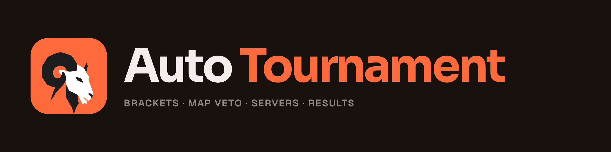

Self-hosted tournament platform. You create the tournament; Auto Tournament
loads each match onto your game servers, tracks the score and moves the
bracket on by itself.

Games plug in as modules: CS2 runs on our own server plugin, Ready Up, and
any other game can run with the captains reporting the score.

| Repository | What it is | License |
|---|---|---|
| [auto-tournament](https://github.com/Auto-Tournament/auto-tournament) | The platform: web app, API and database, shipped as one Docker image. Formerly MatchZy Auto Tournament. | PolyForm Noncommercial |
| [ready-up](https://github.com/Auto-Tournament/ready-up) | Ready Up: the native CS2 match plugin, with no Metamod or CounterStrikeSharp needed. A MatchZy / Get5 alternative that survives CS2 updates. | PolyForm Noncommercial |
| [matchzy-enhanced](https://github.com/Auto-Tournament/matchzy-enhanced) | MatchZy Enhanced: the older CounterStrikeSharp plugin, replaced by Ready Up. Archived. | MIT |
| [cs2-server-manager](https://github.com/Auto-Tournament/cs2-server-manager) | CLI that installs and runs several CS2 servers on one Linux machine. | PolyForm Noncommercial |
| [frame-by-frame](https://github.com/Auto-Tournament/frame-by-frame) | CS2 plugin that records highlight clips one frame at a time, on any GPU. | PolyForm Noncommercial |
| [packs](https://github.com/Auto-Tournament/packs) | Game packs for the platform's game catalog. | PolyForm Noncommercial |
| [docs](https://github.com/Auto-Tournament/docs) | Source for [docs.autotournament.gg](https://docs.autotournament.gg). | PolyForm Noncommercial |

Free for personal and non-commercial use. If you earn money from running the tools, a commercial license is priced per server: see [pricing](https://autotournament.gg/pricing).

[Website](https://autotournament.gg) · [Documentation](https://docs.autotournament.gg) · [Pricing](https://autotournament.gg/pricing) · [Discord](https://discord.gg/n7gHYau7aW)

The Auto Tournament, MatchZy Enhanced and CS2 Server Manager logos were generated with an AI image model (ChatGPT) and then cleaned up and recoloured by hand.
